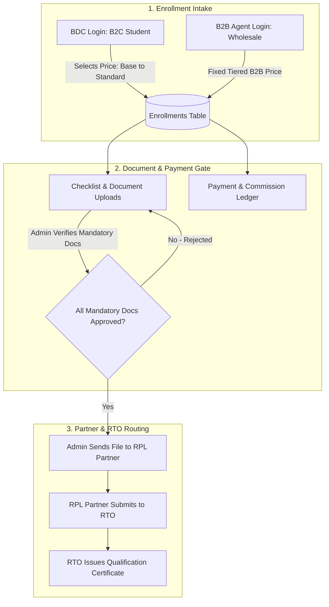
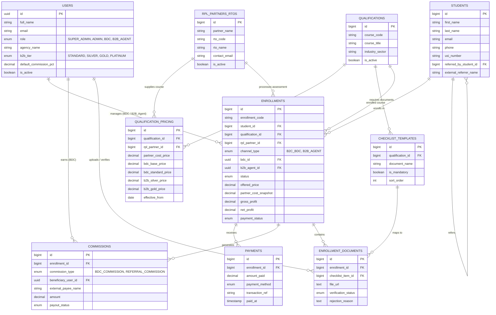
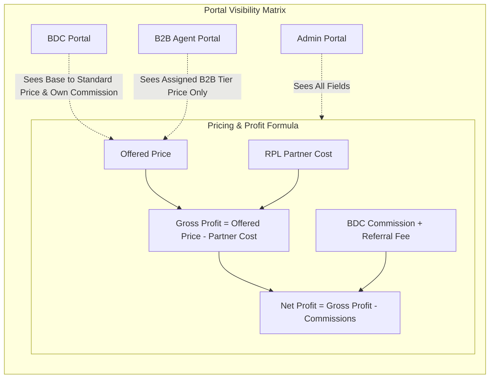

# RPL Management System — Database Architecture & Schema Design

## 1. Executive Overview
This document outlines the relational database architecture for an **RPL (Recognition of Prior Learning) Management & B2B/B2C Portal System**. The architecture supports multi-role access (**Admin**, **BDC**, and **B2B Agents**), dynamic course pricing matrices, financial profit/commission tracking, and document checklist verification workflows prior to RPL Partner and RTO submission.

---

## 2. System Workflow & Data Lifecycle

Before examining the tables, the diagram below illustrates how data flows through the system from initial enrollment to certificate issuance:



---

## 3. Entity-Relationship (ER) Diagram

The following ER diagram illustrates all 10 core tables, their primary/foreign keys, and cardinality relationships.



---

## 4. Detailed Table Specifications

### 4.1. `users`
Manages authentication, portal routing, and role-based access control (RBAC) for Admins, BDCs, and B2B Agents.

| Column | Data Type | Constraints | Description |
| :--- | :--- | :--- | :--- |
| `id` | `UUID` | `PRIMARY KEY` | Unique user identifier |
| `full_name` | `VARCHAR(150)` | `NOT NULL` | Full legal name of staff or agent |
| `email` | `VARCHAR(150)` | `UNIQUE, NOT NULL` | Login username/email |
| `password_hash` | `VARCHAR(255)` | `NOT NULL` | Bcrypt/Argon2 hashed password |
| `phone` | `VARCHAR(30)` | `NULL` | Contact phone number |
| `role` | `VARCHAR(30)` | `NOT NULL` | `'SUPER_ADMIN'`, `'ADMIN'`, `'BDC'`, `'B2B_AGENT'` |
| `agency_name` | `VARCHAR(150)` | `NULL` | Business/Agency name (for `B2B_AGENT`) |
| `b2b_tier` | `VARCHAR(20)` | `DEFAULT 'SILVER'` | `'SILVER'`, `'GOLD'`, `'PLATINUM'` (determines B2B pricing) |
| `default_commission_pct` | `DECIMAL(5,2)` | `DEFAULT 0.00` | Default commission % for BDCs |
| `is_active` | `BOOLEAN` | `DEFAULT TRUE` | Enables/disables login access |
| `created_at` | `TIMESTAMPTZ` | `DEFAULT NOW()` | Account creation timestamp |

---

### 4.2. `rpl_partners_rtos`
Stores the external RPL Partners and issuing Registered Training Organisations (RTOs).

| Column | Data Type | Constraints | Description |
| :--- | :--- | :--- | :--- |
| `id` | `BIGSERIAL` | `PRIMARY KEY` | Unique Partner ID |
| `partner_name` | `VARCHAR(150)` | `NOT NULL` | Name of the intermediary RPL Partner |
| `rto_code` | `VARCHAR(50)` | `NULL` | National RTO registration code |
| `rto_name` | `VARCHAR(150)` | `NULL` | Issuing RTO legal name |
| `contact_email` | `VARCHAR(150)` | `NULL` | Email address for submitting student files |
| `is_active` | `BOOLEAN` | `DEFAULT TRUE` | Whether partner is currently accepting files |

---

### 4.3. `qualifications`
Master catalog of all RPL courses offered.

| Column | Data Type | Constraints | Description |
| :--- | :--- | :--- | :--- |
| `id` | `BIGSERIAL` | `PRIMARY KEY` | Unique Course ID |
| `course_code` | `VARCHAR(50)` | `UNIQUE, NOT NULL` | Official qualification code (e.g., `CPC30220`) |
| `course_title` | `VARCHAR(255)` | `NOT NULL` | Official qualification title |
| `industry_sector` | `VARCHAR(100)` | `NULL` | e.g., Construction, Business, Hospitality, Automotive |
| `is_active` | `BOOLEAN` | `DEFAULT TRUE` | Active status in enrollment dropdowns |

---

### 4.4. `qualification_pricing`
Defines the financial matrix per course and partner. **Security Note:** `partner_cost_price` must be stripped from API responses sent to `BDC` and `B2B_AGENT` roles.

| Column | Data Type | Constraints | Description |
| :--- | :--- | :--- | :--- |
| `id` | `BIGSERIAL` | `PRIMARY KEY` | Pricing rule ID |
| `qualification_id` | `BIGINT` | `FK -> qualifications.id` | Target course |
| `rpl_partner_id` | `BIGINT` | `FK -> rpl_partners_rtos.id` | Fulfilling RPL Partner |
| `partner_cost_price` | `DECIMAL(10,2)` | `NOT NULL` | **Admin Only:** Wholesale cost paid to RPL Partner |
| `bdc_base_price` | `DECIMAL(10,2)` | `NOT NULL` | Minimum floor price a BDC can offer without approval |
| `bdc_standard_price` | `DECIMAL(10,2)` | `NOT NULL` | Standard retail target price for BDCs |
| `b2b_silver_price` | `DECIMAL(10,2)` | `NOT NULL` | Wholesale rate for standard B2B Agents |
| `b2b_gold_price` | `DECIMAL(10,2)` | `NULL` | Discounted wholesale rate for high-volume B2B Agents |
| `currency` | `VARCHAR(10)` | `DEFAULT 'AUD'` | Currency code |
| `effective_from` | `DATE` | `NOT NULL` | Date this pricing structure became active |

---

### 4.5. `students`
Stores candidate information and referral attribution.

| Column | Data Type | Constraints | Description |
| :--- | :--- | :--- | :--- |
| `id` | `BIGSERIAL` | `PRIMARY KEY` | Unique Student ID |
| `first_name` | `VARCHAR(100)` | `NOT NULL` | Legal first name |
| `last_name` | `VARCHAR(100)` | `NOT NULL` | Legal surname |
| `email` | `VARCHAR(150)` | `UNIQUE, NOT NULL` | Student email address |
| `phone` | `VARCHAR(30)` | `NOT NULL` | Student mobile/phone number |
| `dob` | `DATE` | `NULL` | Date of birth |
| `usi_number` | `VARCHAR(20)` | `NULL` | Unique Student Identifier (required for RTO issuance) |
| `address` | `TEXT` | `NULL` | Full residential address |
| `referred_by_student_id`| `BIGINT` | `FK -> students.id, NULL` | Self-referencing FK if referred by a past student |
| `external_referrer_name`| `VARCHAR(150)` | `NULL` | Name of external referrer (if not a student) |
| `created_at` | `TIMESTAMPTZ` | `DEFAULT NOW()` | Record creation timestamp |

---

### 4.6. `enrollments`
The central transactional table locking in pricing snapshots, profit calculations, and application lifecycle status.

| Column | Data Type | Constraints | Description |
| :--- | :--- | :--- | :--- |
| `id` | `BIGSERIAL` | `PRIMARY KEY` | Unique Enrollment ID |
| `enrollment_code` | `VARCHAR(30)` | `UNIQUE, NOT NULL` | Human-readable tracking code (e.g., `RPL-2026-1001`) |
| `student_id` | `BIGINT` | `FK -> students.id` | Enrolled candidate |
| `qualification_id` | `BIGINT` | `FK -> qualifications.id` | Chosen qualification |
| `rpl_partner_id` | `BIGINT` | `FK -> rpl_partners_rtos.id` | Assigned RPL Partner |
| `channel_type` | `VARCHAR(20)` | `NOT NULL` | `'B2C_BDC'` or `'B2B_AGENT'` |
| `bdc_id` | `UUID` | `FK -> users.id, NULL` | BDC who enrolled the student (B2C) |
| `b2b_agent_id` | `UUID` | `FK -> users.id, NULL` | B2B Agent who submitted the student (B2B) |
| `status` | `VARCHAR(30)` | `NOT NULL` | `'LEAD'`, `'DISCOUNT_APPROVAL'`, `'DOCS_PENDING'`, `'ADMIN_REVIEW'`, `'SENT_TO_PARTNER'`, `'SENT_TO_RTO'`, `'CERTIFIED'`, `'CANCELLED'` |
| `offered_price` | `DECIMAL(10,2)` | `NOT NULL` | Agreed price charged to Student or B2B Agent |
| `partner_cost_snapshot`| `DECIMAL(10,2)` | `NOT NULL` | Locked RPL Partner cost at time of enrollment |
| `gross_profit` | `DECIMAL(10,2)` | `NOT NULL` | `offered_price - partner_cost_snapshot` |
| `net_profit` | `DECIMAL(10,2)` | `NOT NULL` | `gross_profit - total_commissions` |
| `payment_status` | `VARCHAR(20)` | `DEFAULT 'UNPAID'` | `'UNPAID'`, `'PARTIAL'`, `'PAID'`, `'REFUNDED'` |
| `submitted_to_partner_at`| `TIMESTAMPTZ` | `NULL` | Timestamp when Admin dispatched file to Partner |
| `certificate_issued_at` | `DATE` | `NULL` | Date RTO issued the certificate |
| `created_at` | `TIMESTAMPTZ` | `DEFAULT NOW()` | Enrollment creation timestamp |

---

### 4.7. `payments`
Logs partial or full installments received against an enrollment.

| Column | Data Type | Constraints | Description |
| :--- | :--- | :--- | :--- |
| `id` | `BIGSERIAL` | `PRIMARY KEY` | Payment transaction ID |
| `enrollment_id` | `BIGINT` | `FK -> enrollments.id` | Linked enrollment |
| `amount_paid` | `DECIMAL(10,2)` | `NOT NULL` | Amount paid in this transaction |
| `payment_method` | `VARCHAR(30)` | `NOT NULL` | `'BANK_TRANSFER'`, `'STRIPE'`, `'CASH'`, `'B2B_INVOICE'` |
| `transaction_ref` | `VARCHAR(100)` | `NULL` | Bank reference or gateway receipt ID |
| `paid_at` | `TIMESTAMPTZ` | `DEFAULT NOW()` | Date/time payment was received |
| `verified_by_admin_id` | `UUID` | `FK -> users.id, NULL` | Admin who confirmed funds clearance |

---

### 4.8. `commissions`
Separates BDC sales commissions and Referral payouts from top-line revenue.

| Column | Data Type | Constraints | Description |
| :--- | :--- | :--- | :--- |
| `id` | `BIGSERIAL` | `PRIMARY KEY` | Commission ID |
| `enrollment_id` | `BIGINT` | `FK -> enrollments.id` | Source enrollment |
| `commission_type` | `VARCHAR(30)` | `NOT NULL` | `'BDC_COMMISSION'` or `'REFERRAL_COMMISSION'` |
| `beneficiary_user_id` | `UUID` | `FK -> users.id, NULL` | BDC user ID (if internal BDC commission) |
| `external_payee_name` | `VARCHAR(150)` | `NULL` | Name/details of external or student referrer |
| `amount` | `DECIMAL(10,2)` | `NOT NULL` | Commission dollar amount |
| `payout_status` | `VARCHAR(20)` | `DEFAULT 'PENDING'` | `'PENDING'`, `'ELIGIBLE'`, `'PAID'`, `'VOID'` |
| `paid_at` | `TIMESTAMPTZ` | `NULL` | Timestamp when commission was disbursed |

---

### 4.9. `checklist_templates`
Configures required RPL evidence items globally or per qualification.

| Column | Data Type | Constraints | Description |
| :--- | :--- | :--- | :--- |
| `id` | `BIGSERIAL` | `PRIMARY KEY` | Checklist template item ID |
| `qualification_id` | `BIGINT` | `FK -> qualifications.id, NULL` | `NULL` = Global requirement (e.g., ID); `ID` = Course-specific |
| `document_name` | `VARCHAR(150)` | `NOT NULL` | e.g., `"100 Points of ID"`, `"Work Video Evidence"` |
| `description` | `TEXT` | `NULL` | Guidelines for valid submission |
| `is_mandatory` | `BOOLEAN` | `DEFAULT TRUE` | Blocks Partner submission until approved |
| `sort_order` | `INT` | `DEFAULT 0` | UI ordering |

---

### 4.10. `enrollment_documents`
Tracks uploaded student evidence files and Admin verification states.

| Column | Data Type | Constraints | Description |
| :--- | :--- | :--- | :--- |
| `id` | `BIGSERIAL` | `PRIMARY KEY` | Uploaded file record ID |
| `enrollment_id` | `BIGINT` | `FK -> enrollments.id` | Associated enrollment |
| `checklist_item_id` | `BIGINT` | `FK -> checklist_templates.id` | Checklist requirement being fulfilled |
| `file_url` | `TEXT` | `NOT NULL` | Cloud storage URL (S3 / Google Drive) |
| `file_name` | `VARCHAR(255)` | `NOT NULL` | Original uploaded filename |
| `uploaded_by_user_id` | `UUID` | `FK -> users.id` | BDC, B2B Agent, or Admin who uploaded |
| `verification_status` | `VARCHAR(20)` | `DEFAULT 'UPLOADED'` | `'UPLOADED'`, `'APPROVED'`, `'REJECTED'` |
| `rejection_reason` | `TEXT` | `NULL` | Reason if Admin rejects the file |
| `verified_by_admin_id` | `UUID` | `FK -> users.id, NULL` | Admin who reviewed the document |
| `uploaded_at` | `TIMESTAMPTZ` | `DEFAULT NOW()` | Upload timestamp |

---

## 5. Role-Based Access & Pricing Logic



---

## 6. PostgreSQL DDL Script (Ready to Execute)

```sql
-- Enable UUID extension
CREATE EXTENSION IF NOT EXISTS "uuid-ossp";

-- 1. USERS TABLE
CREATE TABLE users (
    id UUID PRIMARY KEY DEFAULT uuid_generate_v4(),
    full_name VARCHAR(150) NOT NULL,
    email VARCHAR(150) UNIQUE NOT NULL,
    password_hash VARCHAR(255) NOT NULL,
    phone VARCHAR(30),
    role VARCHAR(30) NOT NULL CHECK (role IN ('SUPER_ADMIN', 'ADMIN', 'BDC', 'B2B_AGENT')),
    agency_name VARCHAR(150),
    b2b_tier VARCHAR(20) DEFAULT 'SILVER' CHECK (b2b_tier IN ('SILVER', 'GOLD', 'PLATINUM')),
    default_commission_pct DECIMAL(5,2) DEFAULT 0.00,
    is_active BOOLEAN DEFAULT TRUE,
    created_at TIMESTAMPTZ DEFAULT NOW()
);

-- 2. RPL PARTNERS & RTOS
CREATE TABLE rpl_partners_rtos (
    id BIGSERIAL PRIMARY KEY,
    partner_name VARCHAR(150) NOT NULL,
    rto_code VARCHAR(50),
    rto_name VARCHAR(150),
    contact_email VARCHAR(150),
    is_active BOOLEAN DEFAULT TRUE
);

-- 3. QUALIFICATIONS
CREATE TABLE qualifications (
    id BIGSERIAL PRIMARY KEY,
    course_code VARCHAR(50) UNIQUE NOT NULL,
    course_title VARCHAR(255) NOT NULL,
    industry_sector VARCHAR(100),
    is_active BOOLEAN DEFAULT TRUE
);

-- 4. QUALIFICATION PRICING
CREATE TABLE qualification_pricing (
    id BIGSERIAL PRIMARY KEY,
    qualification_id BIGINT NOT NULL REFERENCES qualifications(id) ON DELETE CASCADE,
    rpl_partner_id BIGINT NOT NULL REFERENCES rpl_partners_rtos(id) ON DELETE RESTRICT,
    partner_cost_price DECIMAL(10,2) NOT NULL,
    bdc_base_price DECIMAL(10,2) NOT NULL,
    bdc_standard_price DECIMAL(10,2) NOT NULL,
    b2b_silver_price DECIMAL(10,2) NOT NULL,
    b2b_gold_price DECIMAL(10,2),
    currency VARCHAR(10) DEFAULT 'AUD',
    effective_from DATE NOT NULL DEFAULT CURRENT_DATE,
    UNIQUE (qualification_id, rpl_partner_id, effective_from)
);

-- 5. STUDENTS
CREATE TABLE students (
    id BIGSERIAL PRIMARY KEY,
    first_name VARCHAR(100) NOT NULL,
    last_name VARCHAR(100) NOT NULL,
    email VARCHAR(150) UNIQUE NOT NULL,
    phone VARCHAR(30) NOT NULL,
    dob DATE,
    usi_number VARCHAR(20),
    address TEXT,
    referred_by_student_id BIGINT REFERENCES students(id) ON DELETE SET NULL,
    external_referrer_name VARCHAR(150),
    created_at TIMESTAMPTZ DEFAULT NOW()
);

-- 6. ENROLLMENTS
CREATE TABLE enrollments (
    id BIGSERIAL PRIMARY KEY,
    enrollment_code VARCHAR(30) UNIQUE NOT NULL,
    student_id BIGINT NOT NULL REFERENCES students(id) ON DELETE RESTRICT,
    qualification_id BIGINT NOT NULL REFERENCES qualifications(id) ON DELETE RESTRICT,
    rpl_partner_id BIGINT NOT NULL REFERENCES rpl_partners_rtos(id) ON DELETE RESTRICT,
    channel_type VARCHAR(20) NOT NULL CHECK (channel_type IN ('B2C_BDC', 'B2B_AGENT')),
    bdc_id UUID REFERENCES users(id) ON DELETE SET NULL,
    b2b_agent_id UUID REFERENCES users(id) ON DELETE SET NULL,
    status VARCHAR(30) NOT NULL DEFAULT 'DOCS_PENDING' CHECK (
        status IN ('LEAD', 'DISCOUNT_APPROVAL', 'DOCS_PENDING', 'ADMIN_REVIEW', 'SENT_TO_PARTNER', 'SENT_TO_RTO', 'CERTIFIED', 'CANCELLED')
    ),
    offered_price DECIMAL(10,2) NOT NULL,
    partner_cost_snapshot DECIMAL(10,2) NOT NULL,
    gross_profit DECIMAL(10,2) NOT NULL,
    net_profit DECIMAL(10,2) NOT NULL,
    payment_status VARCHAR(20) DEFAULT 'UNPAID' CHECK (payment_status IN ('UNPAID', 'PARTIAL', 'PAID', 'REFUNDED')),
    submitted_to_partner_at TIMESTAMPTZ,
    certificate_issued_at DATE,
    created_at TIMESTAMPTZ DEFAULT NOW()
);

-- 7. PAYMENTS
CREATE TABLE payments (
    id BIGSERIAL PRIMARY KEY,
    enrollment_id BIGINT NOT NULL REFERENCES enrollments(id) ON DELETE CASCADE,
    amount_paid DECIMAL(10,2) NOT NULL,
    payment_method VARCHAR(30) NOT NULL CHECK (payment_method IN ('BANK_TRANSFER', 'STRIPE', 'CASH', 'B2B_INVOICE')),
    transaction_ref VARCHAR(100),
    paid_at TIMESTAMPTZ DEFAULT NOW(),
    verified_by_admin_id UUID REFERENCES users(id) ON DELETE SET NULL
);

-- 8. COMMISSIONS
CREATE TABLE commissions (
    id BIGSERIAL PRIMARY KEY,
    enrollment_id BIGINT NOT NULL REFERENCES enrollments(id) ON DELETE CASCADE,
    commission_type VARCHAR(30) NOT NULL CHECK (commission_type IN ('BDC_COMMISSION', 'REFERRAL_COMMISSION')),
    beneficiary_user_id UUID REFERENCES users(id) ON DELETE SET NULL,
    external_payee_name VARCHAR(150),
    amount DECIMAL(10,2) NOT NULL,
    payout_status VARCHAR(20) DEFAULT 'PENDING' CHECK (payout_status IN ('PENDING', 'ELIGIBLE', 'PAID', 'VOID')),
    paid_at TIMESTAMPTZ
);

-- 9. CHECKLIST TEMPLATES
CREATE TABLE checklist_templates (
    id BIGSERIAL PRIMARY KEY,
    qualification_id BIGINT REFERENCES qualifications(id) ON DELETE CASCADE,
    document_name VARCHAR(150) NOT NULL,
    description TEXT,
    is_mandatory BOOLEAN DEFAULT TRUE,
    sort_order INT DEFAULT 0
);

-- 10. ENROLLMENT DOCUMENTS
CREATE TABLE enrollment_documents (
    id BIGSERIAL PRIMARY KEY,
    enrollment_id BIGINT NOT NULL REFERENCES enrollments(id) ON DELETE CASCADE,
    checklist_item_id BIGINT NOT NULL REFERENCES checklist_templates(id) ON DELETE RESTRICT,
    file_url TEXT NOT NULL,
    file_name VARCHAR(255) NOT NULL,
    uploaded_by_user_id UUID NOT NULL REFERENCES users(id) ON DELETE RESTRICT,
    verification_status VARCHAR(20) DEFAULT 'UPLOADED' CHECK (verification_status IN ('UPLOADED', 'APPROVED', 'REJECTED')),
    rejection_reason TEXT,
    verified_by_admin_id UUID REFERENCES users(id) ON DELETE SET NULL,
    uploaded_at TIMESTAMPTZ DEFAULT NOW()
);

-- INDEXES FOR PERFORMANCE
CREATE INDEX idx_enrollments_status ON enrollments(status);
CREATE INDEX idx_enrollments_bdc ON enrollments(bdc_id);
CREATE INDEX idx_enrollments_b2b_agent ON enrollments(b2b_agent_id);
CREATE INDEX idx_enrollments_student ON enrollments(student_id);
CREATE INDEX idx_docs_enrollment ON enrollment_documents(enrollment_id);
CREATE INDEX idx_commissions_beneficiary ON commissions(beneficiary_user_id, payout_status);
```